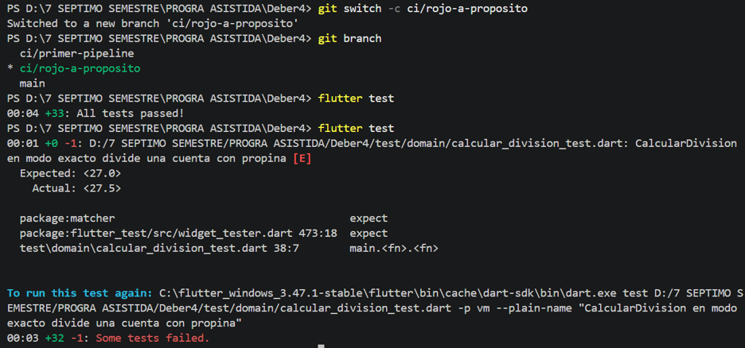
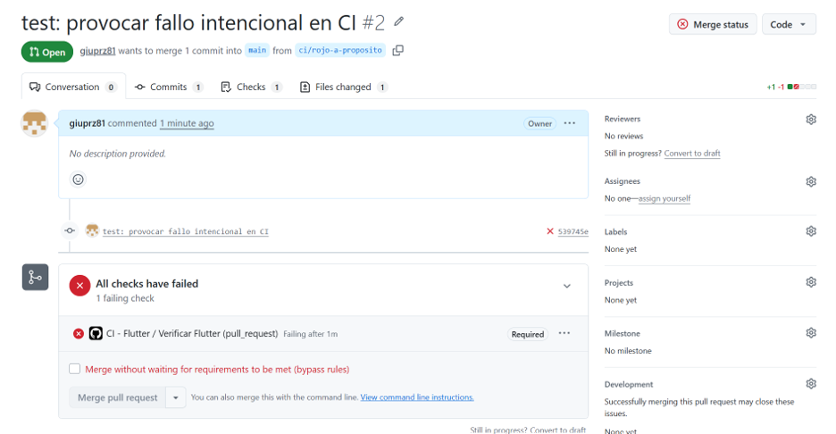
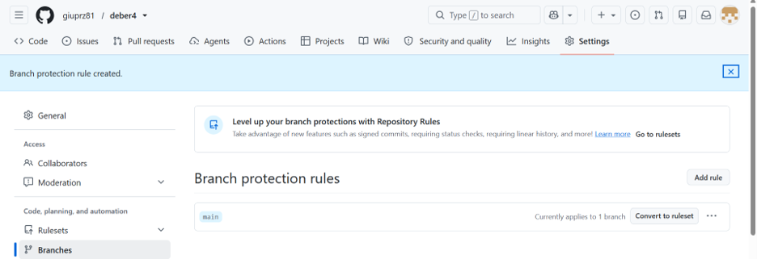
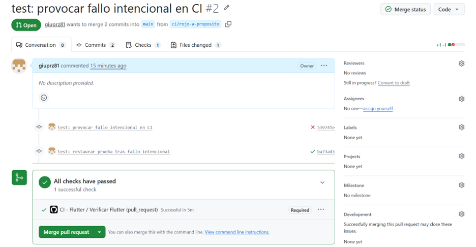
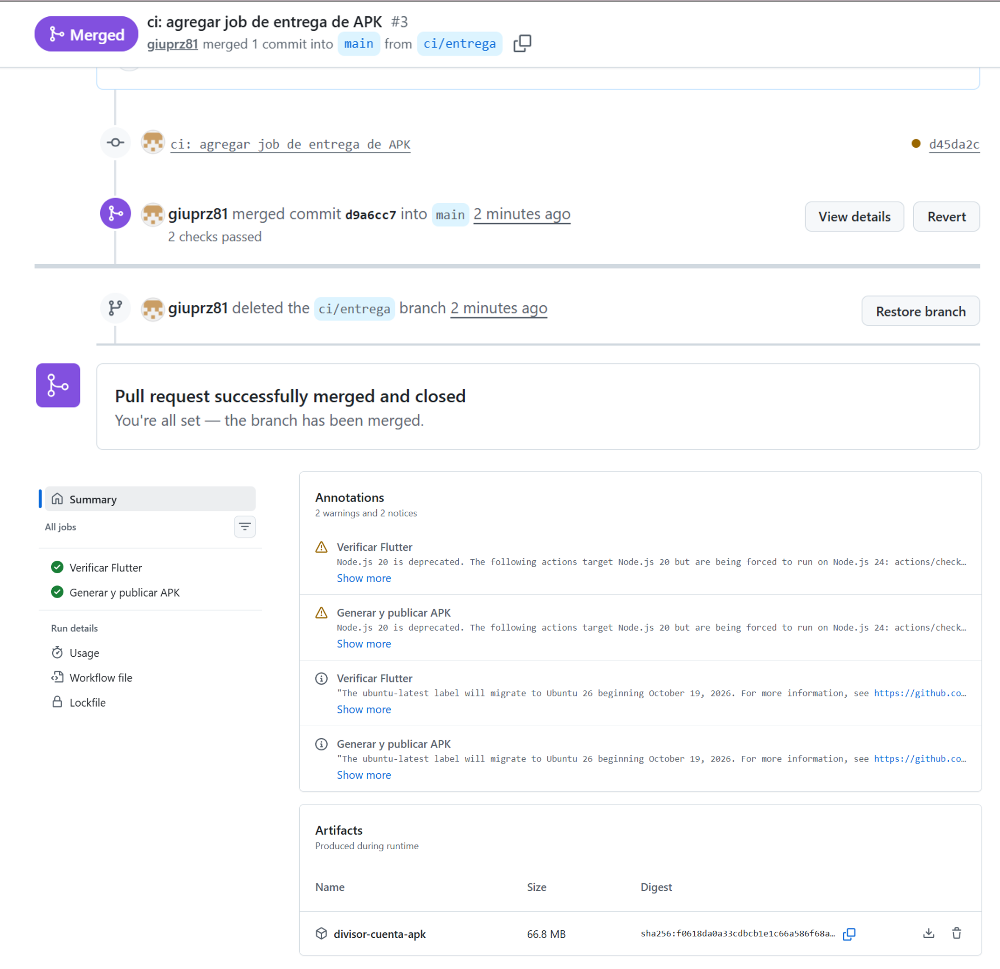

# Deber 4 — De TDD a CI/CD: automatizar la verificación
## 1. Workflow de CI

El archivo `.github/workflows/ci.yml` contiene el siguiente workflow:

```yaml
name: CI - Flutter

on:
  push:
    branches:
      - main

  pull_request:
    branches:
      - main

jobs:
  ci:
    name: Verificar Flutter
    runs-on: ubuntu-latest

    steps:
      - name: Descargar código
        uses: actions/checkout@v4

      - name: Configurar Flutter
        uses: subosito/flutter-action@v2
        with:
          channel: stable

      - name: Obtener dependencias
        run: flutter pub get

      - name: Analizar código
        run: flutter analyze

      - name: Ejecutar pruebas
        run: flutter test

      - name: Compilar APK
        run: flutter build apk --debug

  entrega:
    name: Generar y publicar APK
    needs: ci
    if: github.event_name == 'push' && github.ref == 'refs/heads/main'
    runs-on: ubuntu-latest

    steps:
      - name: Descargar código
        uses: actions/checkout@v4

      - name: Configurar Flutter
        uses: subosito/flutter-action@v2
        with:
          channel: stable

      - name: Obtener dependencias
        run: flutter pub get

      - name: Generar APK
        run: flutter build apk --debug

      - name: Publicar APK como artefacto
        uses: actions/upload-artifact@v4
        with:
          name: divisor-cuenta-apk
          path: build/app/outputs/flutter-apk/app-debug.apk
          if-no-files-found: error
          retention-days: 7
```

### Función de los comandos

- **`flutter analyze`:** analiza el código Dart para detectar errores, problemas estáticos y advertencias.
- **`flutter test`:** ejecuta las pruebas automatizadas del proyecto y verifica que los resultados sean los esperados.
- **`flutter build apk --debug`:** compila la aplicación Flutter y genera un APK de depuración.

El workflow se ejecuta cuando se realiza un push a `main` o se abre o actualiza un pull request dirigido a `main`.

El job `entrega` depende del job `ci`, por lo que solo se ejecuta cuando el CI ha pasado y el evento corresponde a un push a `main`. Genera el APK y lo publica como artefacto descargable.

## 2. Evidencia del fallo intencional

Para comprobar que el pipeline detecta errores, modifiqué intencionalmente el resultado esperado de una prueba del proyecto.

La prueba se encontraba en:

`test/domain/calcular_division_test.dart`

Se cambió el valor esperado de `27.5` a `27.0`, manteniendo el resultado real de la aplicación en `27.5`.

El log de Flutter mostró:

```text
Expected: <27.0>
Actual: <27.5>
```

La línea del log que identificó exactamente el problema fue:

```text
test\domain\calcular_division_test.dart 38:7
main.<fn>.<fn>
```

Esto permitió localizar la prueba que estaba fallando.

La ejecución de CI terminó en rojo porque una de las pruebas no cumplía el resultado esperado.

### Evidencias





## 3. Diferencia entre Continuous Integration, Continuous Delivery y Continuous Deployment

**Continuous Integration (CI):** consiste en integrar cambios de código frecuentemente y ejecutar automáticamente verificaciones, como análisis estático, pruebas y compilaciones, para detectar problemas antes de unir los cambios a la rama principal.

**Continuous Delivery:** consiste en automatizar el proceso para que el software validado quede preparado para ser entregado o desplegado, normalmente con una aprobación humana antes de su publicación.

**Continuous Deployment:** consiste en desplegar automáticamente a producción los cambios que superan las verificaciones, sin requerir una aprobación manual para cada despliegue.

En este proyecto implementé principalmente **Continuous Integration**, porque el workflow analiza el código, ejecuta las pruebas y compila la aplicación antes de permitir que los cambios se integren a `main`.

También incorporé una etapa de entrega automatizada del APK como artefacto. Sin embargo, no implementé un despliegue a producción.

## 4. Protección de la rama main

Configuré una regla de protección para la rama `main` en GitHub.

La configuración exige:

- Que los cambios ingresen mediante un pull request.
- Que los checks de estado requeridos pasen antes del merge.
- Que el check de GitHub Actions correspondiente al CI sea satisfactorio.

Cuando introduje el fallo intencional en una prueba, el check de CI falló y GitHub bloqueó el merge del pull request.

Esto evita integrar cambios que no superan las verificaciones automatizadas y reduce el riesgo de que la rama principal quede con una versión que no funciona correctamente.

### Evidencia



## 5. Revisión crítica del agente

Utilicé Codex para revisar el archivo `.github/workflows/ci.yml` e identificar riesgos y posibles mejoras.

El agente recomendó:

- Fijar una versión concreta de Flutter para mejorar la reproducibilidad.
- Evitar compilar el APK dos veces.
- Incorporar una validación de formato Dart.
- Declarar permisos mínimos para el `GITHUB_TOKEN`.
- Fijar las acciones de GitHub a SHA completos.
- Corregir nombres de pasos si presentan problemas de codificación.
- Mantener `--debug` para el alcance académico del deber.

### Recomendaciones aceptadas como mejoras futuras

Considero útiles declarar permisos mínimos y fijar las acciones a SHA completos, ya que estas prácticas pueden mejorar la seguridad y la trazabilidad del workflow.

También es conveniente corregir cualquier problema de codificación que afecte la legibilidad de los nombres de los pasos.

### Recomendaciones que no implementé

No fijé una versión específica de Flutter porque las instrucciones del deber solicitan utilizar el canal estable (`stable`).

Tampoco eliminé la compilación separada del job `entrega`, porque las instrucciones permiten que ese job vuelva a generar el APK.

No agregué el comando de formato Dart porque no forma parte de los comandos obligatorios del workflow de esta actividad.

La revisión del agente fue útil para identificar oportunidades de mejora, pero evalué sus recomendaciones según las instrucciones del deber y el alcance del proyecto.

## 6. ¿Qué garantiza realmente un CI verde y qué errores pueden quedar sin detectar?

Un CI verde garantiza que el código superó las verificaciones automatizadas configuradas en el workflow para esa ejecución.

En este proyecto, significa que:

- Las dependencias se pudieron obtener.
- El análisis estático de Flutter terminó correctamente.
- Las pruebas automatizadas pasaron.
- La aplicación pudo compilarse como APK de depuración.

Sin embargo, un CI verde no garantiza que la aplicación esté libre de todos los errores.

Por ejemplo, una prueba podría pasar correctamente, pero la aplicación todavía podría tener un problema visual en una pantalla que no fue cubierta por las pruebas automatizadas.

También podrían existir errores de experiencia de usuario, problemas que ocurran únicamente en ciertos dispositivos o fallos en funcionalidades que no tienen pruebas.

Por eso, el CI ayuda a detectar problemas, pero no reemplaza completamente las pruebas manuales ni la revisión del código.

## 7. ¿Qué detectó el pipeline que yo no había visto?

Durante la actividad comprobé que el pipeline detectó el fallo intencional que introduje en una prueba del proyecto.

La prueba esperaba un resultado de `27.0`, pero la aplicación devolvía `27.5`. Aunque el proyecto funcionaba correctamente antes de modificar la prueba, el pipeline detectó que el resultado esperado no coincidía con el resultado real.

Esto demostró que las pruebas automatizadas pueden detectar inconsistencias y evitar que un cambio incorrecto se integre a la rama principal.

También comprobé que, cuando la prueba falla, GitHub bloquea el merge debido a la protección configurada para `main`.

Después de restaurar el valor esperado, el CI volvió a pasar y el merge quedó habilitado.

## Evidencias adicionales

### CI verde después de restaurar la prueba



### Artefacto APK publicado



